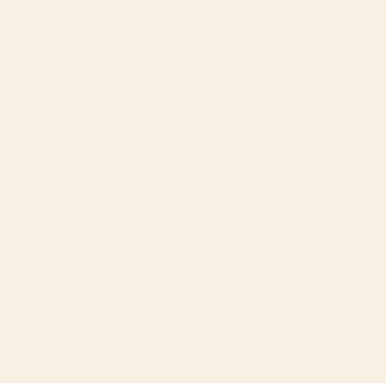

# sendflowrs



Send someone a bouquet of ASCII-art flowers that blooms when they open the link.

**[sendflowrs.com](https://sendflowrs.com)**

Pick up to five flowers and a colour palette, add a note if you like, and share the link, a QR code or the bouquet as plain text. No accounts, no analytics.

## How it works

```
vector petals  →  tiny canvas, one pixel per character  →  coloured characters
                        (about 72 × 37)                     from  .:-=+*o#%@
```

Flowers are drawn as vector shapes on a small offscreen canvas. Each pixel becomes one character: its alpha picks the density and its colour tints the glyph. Glyphs come from a lazily built atlas, so a frame is mostly `drawImage` calls. The loop draws at up to 30 frames per second, drops to a coarser grid on slow devices, and stops completely when the bloom ends.

A gift is only its data (species, palette, seed, text), so the same link always grows the same bouquet.

```
browser  →  POST /api/gifts  →  Cloudflare Worker  →  KV (expires after 1 year)
```

One Worker serves the static app and a small JSON API. The browser and Worker share one validator in [`src/gift/gift.ts`](src/gift/gift.ts).

## Size

| What | Gzipped |
|---|---|
| JavaScript on every page | 8.3 KB |
| QR library, loaded only on the share screen | 7.3 KB |
| CSS | 1.7 KB |

There's no UI framework or font download, and the QR library is the only runtime dependency. CI fails if the JavaScript on every page exceeds 30 KB.

## Security

**Gift codes** are encrypted in the browser with AES-GCM and a random 128-bit key. The key goes after the `#` in the link (`sendflowrs.com/a8f3k2q#key`), and browsers don't send that part to servers. The Worker stores only the ciphertext, so a leak of the database exposes no codes.

This doesn't protect against someone who has the full link: anyone holding it can read the code, and the composer says so. If a chat app strips the `#` part, the bouquet and note still show, and only the code can't be revealed.

**Notes and names** are stored unencrypted and inserted only as text, never as HTML. Links in them aren't clickable, so the site is a poor tool for phishing.

**The Worker** validates every gift itself, limits gifts per IP address, and caps the body at 2 KB. The rate limit is approximate by Cloudflare's design: it slows abuse but isn't a hard cap. Pages carry a strict Content Security Policy and a no-referrer policy.

## Local setup

Requires Node 24.

```bash
npm install
npm run build
npx wrangler dev
```

Open http://localhost:8787. `npx vite` serves the front end alone, and [`dev/gallery.html`](dev/gallery.html) shows every species and palette.

```bash
npm run typecheck
npm test
npm run size
```

## Deploy

```bash
npx wrangler kv namespace create GIFTS
```

Put the returned ID in `wrangler.jsonc`, replace `REPORT_EMAIL_HERE` in `index.html`, then:

```bash
npm run build
npx wrangler deploy
```

## Licence

[MIT](LICENSE)
